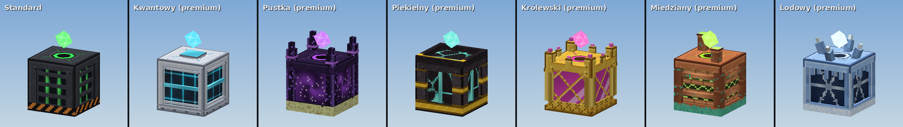
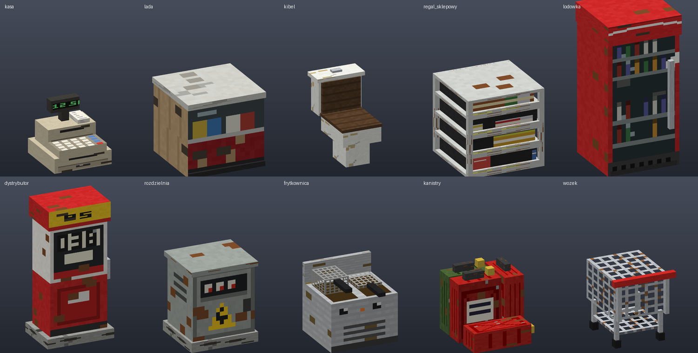
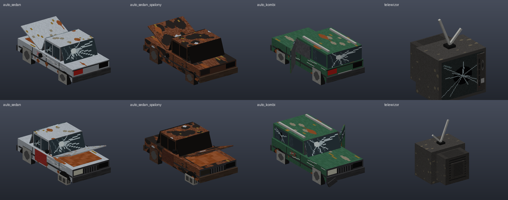

# QualityArmory texturepack (AXON)

Paczka zasobów do QualityArmory na Paper 1.21.4, działa na klientach od 1.21 do 1.21.11. To kopia domyślnej paczki `QualityArmory-21.zip` (QualityGuns 2.1.9) z autorskimi, szczegółowymi modelami broni. Reszta broni, dźwięki i numery modeli są bez zmian.

| Broń | Przedmiot | custom_model_data | Model w paczce |
|---|---|---|---|
| AK47 | crossbow | 4 | `qualityarmory:gun/ak47` |
| Remington 870 | crossbow | 7 | `qualityarmory:gun/remmington` |
| M4A1-S | crossbow | 25 | `qualityarmory:gun/m4a1s` |
| Makarov PM | crossbow | 53 | `qualityarmory:gun/makarov` |
| AWP | crossbow | 20 | `qualityarmory:gun/awp` |
| MAC-10 | crossbow | 48 | `qualityarmory:gun/mac10` |
| M16A2 | crossbow | 6 | `qualityarmory:gun/m16` |
| SKS-45 | crossbow | 51 | `qualityarmory:gun/sks` |
| Desert Eagle .50 AE | crossbow | 78 | `qualityarmory:gun/deagle` |
| SW1911 (Colt 1911) | crossbow | 11 | `qualityarmory:gun/sw1911` |
| P30 | crossbow | 1 | `qualityarmory:gun/p30` |
| MP5 | crossbow | 3 | `qualityarmory:gun/mp5` |
| Uzi | crossbow | 49 | `qualityarmory:gun/uzi` |
| SG 553 | crossbow | 27 | `qualityarmory:gun/sg553` |
| FAMAS F1 | crossbow | 64 | `qualityarmory:gun/famas` |
| Dragunov SVD | crossbow | 16 | `qualityarmory:gun/dragunov` |
| Kar98k | crossbow | 60 | `qualityarmory:gun/kar98k` |
| SPAS-12 | crossbow | 17 | `qualityarmory:gun/spas` |

Zmienione pliki względem oryginału:
- `assets/qualityarmory/models/gun/<broń>.json` – nowe modele (AK 75 elementów, M4 76, Remington 56, Makarov 30, AWP 119, MAC-10 35, M16 63, SKS 59, Desert Eagle 34, SW1911 44, P30 34, MP5 54, Uzi 33, SG 553 50, FAMAS 39, Dragunov 94, Kar98k 49, SPAS-12 26).
- `assets/qualityarmory/textures/axon/<broń>.png` – tekstury 128×128 (małe bronie mają gęstsze teksele).
- `assets/minecraft/atlases/blocks.json` – dodane źródło `axon/` (bez tego tekstury byłyby fioletowo-czarne).
- `pack.mcmeta` – opis zaczyna się od „AXON”, żeby w grze było widać, która paczka jest wczytana; formaty 34–75 i nakładki (overlays) dla starszych wersji.

## Wersje Minecrafta (1.21–1.21.11)

Jedna paczka działa na wszystkich wersjach 1.21.x. `pack.mcmeta` deklaruje formaty 34–75 w obu zapisach (stary `pack_format` + `supported_formats` i nowy `min_format`/`max_format` od 1.21.9), a różnice między wersjami załatwiają nakładki (`overlays`), które gra wczytuje tylko na pasujących wersjach:

| Katalog w zipie | Wersje | Co zawiera |
|---|---|---|
| `axon_1_21_0/` | 1.21–1.21.3 | Te wersje nie czytają `assets/*/items/`, więc wszystkie numery `custom_model_data` (bronie, skiny, amunicja, czapki, pojazdy, reaktor) są tam jeszcze raz jako stare `overrides` w `models/item/*.json`, a modele z `assets/axon/items/` mają odpowiedniki w `models/item/` dla komponentu `item_model` (1.21.2–1.21.3). |
| `axon_shadery/` | 1.21.2–1.21.5 | Shadery AxonMap. |
| `axon_shadery_1_21_0/` | 1.21–1.21.1 | Te same shadery w zapisie sprzed 1.21.2 (nazwy bez `minecraft:`). |

Od 1.21.6 shadery mają inny format, więc tam paczka ich nie dodaje (mapa AxonMap na cały ekran wymaga przepisania shaderów). Na 1.21–1.21.1 nie ma komponentu `item_model`, więc rekwizyty AXON-Structure (zrzut, meble, auta) wyświetlają się tylko od 1.21.2; bronie, skiny i reaktor działają wszędzie.

Paczka była wczytana w prawdziwym kliencie 1.21.1, 1.21.3, 1.21.5 i 1.21.11 (bez błędów modeli i shaderów; na 1.21.1 i 1.21.3 sprawdzone, że nakładka z `overrides` się wczytuje). `QualityArmory-21-axon-1.21.11.zip` to teraz kopia tej samej paczki, zostawiona, żeby stare linki działały.

## Skiny premium

Skin używa tego samego modelu co bazowa broń (te same elementy i pozycje, także celowanie), różni się tylko teksturą. Generuje je `gen.py` (słownik `SKINS`; AK ma własne malowania, reszta broni wspólne motywy z `generic_skin`), a `build_pack.py` dopisuje je do `assets/minecraft/items/crossbow.json`. Numery idą blokami po dziesięć na broń, bo oryginalne numery QA kończą się na 85.

Motywy: Złoto (złoto z grawerem, heban), Neon (czarny mat i karbon, świecące krawędzie cyan/magenta), Polar (biały, pomarańczowe i czarne pasy), Damast (stal damasceńska, czerwone drewno, mosiądz), Lawa (obsydian z żarzącymi się pęknięciami), Galaktyka (mgławica z gwiazdami, chromowane części), Holo (tęczowa folia holograficzna). Każda broń ma wszystkie siedem.

| Broń | custom_model_data | Kolejność motywów | name w QualityArmory (`/qa give <gracz> <name>`) |
|---|---|---|---|
| AK47 | 101–107 | Złoto, Neon, Polar, Damast, Lawa, Galaktyka, Holo | `ak47_<motyw>` |
| M4A1-S | 111–117 | Złoto, Neon, Lawa, Galaktyka, Polar, Damast, Holo | `m4a1s_<motyw>` |
| Remington | 121–127 | Złoto, Neon, Lawa, Galaktyka, Damast, Polar, Holo | `remmington_<motyw>` |
| Makarov | 131–137 | Złoto, Neon, Lawa, Galaktyka, Damast, Polar, Holo | `makarov_<motyw>` |
| AWP | 141–147 | Złoto, Neon, Lawa, Galaktyka, Damast, Polar, Holo | `awp_<motyw>` |
| M16 | 151–157 | Złoto, Neon, Lawa, Galaktyka, Damast, Polar, Holo | `m16_<motyw>` |
| MAC-10 | 161–167 | Złoto, Neon, Lawa, Galaktyka, Damast, Polar, Holo | `mac10_<motyw>` |
| SKS | 171–177 | Złoto, Neon, Lawa, Galaktyka, Damast, Polar, Holo | `sks_<motyw>` |
| Desert Eagle | 181–187 | Złoto, Neon, Lawa, Galaktyka, Damast, Polar, Holo | `deagle_<motyw>` |
| SW1911 | 191–197 | Złoto, Neon, Lawa, Galaktyka, Damast, Polar, Holo | `sw1911_<motyw>` |
| P30 | 201–207 | Złoto, Neon, Lawa, Galaktyka, Damast, Polar, Holo | `p30_<motyw>` |
| MP5 | 211–217 | Złoto, Neon, Lawa, Galaktyka, Damast, Polar, Holo | `mp5_<motyw>` |
| Uzi | 221–227 | Złoto, Neon, Lawa, Galaktyka, Damast, Polar, Holo | `uzi_<motyw>` |
| SG553 | 231–237 | Złoto, Neon, Lawa, Galaktyka, Damast, Polar, Holo | `sg553_<motyw>` |
| FAMAS | 241–247 | Złoto, Neon, Lawa, Galaktyka, Damast, Polar, Holo | `famas_<motyw>` |
| Dragunov | 251–257 | Złoto, Neon, Lawa, Galaktyka, Damast, Polar, Holo | `dragunov_<motyw>` |
| Kar98k | 261–267 | Złoto, Neon, Lawa, Galaktyka, Damast, Polar, Holo | `kar98k_<motyw>` |
| SPAS-12 | 271–277 | Złoto, Neon, Lawa, Galaktyka, Damast, Polar, Holo | `spas_<motyw>` |

`<motyw>` to `zloto`, `neon`, `lawa`, `galaktyka`, `polar`, `damast` albo `holo` (np. `deagle_holo`, numer 187).

Model w paczce to `qualityarmory:gun/<name>`. Na serwerze skin to „attachment” QualityArmory z `baseGun` ustawionym na bazową broń, więc przejmuje jej statystyki. Pliki z `serwer/attachments/` trzeba skopiować do `plugins/QualityArmory/attachments/` i zrestartować serwer. Skiny nie są do craftingu ani w sklepie QA.

## Mapa AxonMap (shader)

Paczka zawiera też shadery `rendertype_text` i `position_tex_color` (w nakładkach `axon_shadery*`, na 1.21–1.21.5) z pluginu [AxonMap](https://github.com/toMiXgaming/AXONMAP). Rysuje on mapę świata na cały ekran po wpisaniu `/mapa`. Shader rozpoznaje tylko mapy pluginu (po znaczniku w pierwszym wierszu), więc zwykłe napisy, tabliczki i mapy działają jak wcześniej. Przy otwartej mapie chowają też hotbar, serduszka i celownik. Źródła są w `zrodla/shadery/`, a `build_pack.py` dodaje je do zipa.

## Reaktor działki (AxonPlot)

Rdzeń działki z [AxonPlot](https://github.com/toMiXgaming/AXONPLOT) wygląda jak reaktor. Plugin stawia na bloku rdzenia ItemDisplay z przedmiotem `crying_obsidian` i `custom_model_data`, a `assets/minecraft/items/crying_obsidian.json` wybiera po tej liczbie model z `assets/axon/`. Zwykły crying obsidian (bez liczby) wygląda jak w vanilli.

Numer modelu to `7100 + 20 × skin + stan`, gdzie stan to 1 zasilony, 2 mało paliwa (przygaszony żółty, migocze), 3 wygaszony, 4 atak (czerwony, szybki puls). Kryształ nad reaktorem ma numer o 10 większy (wygaszony reaktor go nie ma).

| Skin | Obudowa | Kryształ | Zasilony świeci |
|---|---|---|---|
| 0 Standard | 7101–7104 | 7111–7114 | zielono |
| 1 Kwantowy | 7121–7124 | 7131–7134 | błękitnie |
| 2 Pustka | 7141–7144 | 7151–7154 | fioletowo |
| 3 Piekielny | 7161–7164 | 7171–7174 | turkusowo (ogień dusz) |
| 4 Królewski | 7181–7184 | 7191–7194 | różowo |
| 5 Miedziany | 7201–7204 | 7211–7214 | limonkowo (iskry w cewkach) |
| 6 Lodowy | 7221–7224 | 7231–7234 | mroźną bielą |



Obudowa ma wgłębienia, więc plugin pokazuje ją w skali 1,2 (inaczej prawdziwy blok przebijałby przez okna). Energia w oknach, emiter na górze i kryształ są animowanymi teksturami (`.png.mcmeta`). Generator: `zrodla/gen_reactor.py`, podglądy i miniatury do menu w pluginie (`out/miniatury/`, kopiowane do `AXONPLOT/src/main/resources/reactor/`): `zrodla/preview_reactor.py`, dopisanie do gotowego zipa bez pełnej przebudowy: `zrodla/dodaj_reaktor.py` (pełna przebudowa `build_pack.py` też dodaje reaktor). Gotowe pliki są w `modele/reactor/`, podglądy w `podglady/reaktor-*`.

## Zrzut (AXON-Structure)

Model skrzyni zrzutu: oliwkowa skrzynia z okuciami, pasem ostrzegawczym, złożonym spadochronem na wieku i świecącą czerwoną lampą. Przedmiot `axon:zrzut` (komponent `item_model`, dowolny materiał), model `axon:block/zrzut`, tekstura `axon:item/zrzut` (64×64). Plugin AXON-Structure stawia w strukturze beczkę jako prawdziwy pojemnik i nad nią wyświetlacz przedmiotu z tym modelem; model jest odrobinę większy od bloku, więc beczki nie widać. Generator: `zrodla/gen_zrzut.py`, podgląd: `podglady/zrzut.png`.

## Rekwizyty do struktur (AXON-Structure)

`zrodla/gen_rekwizyty.py` robi dwa modele stawiane przez plugin AXON-Structure jako wyświetlacze przedmiotów:

- `axon:wrak_mi8` – wrak śmigłowca Mi-8 na lądowisku jednostki wojskowej: przeszklony kokpit, otwarte drzwi przesuwne (da się wejść do środka po skrzynię), silniki, połamane łopaty, belka ogonowa z szachownicą, zbiorniki paliwa. Model opisany jest w kratkach `jednostka.axs`; plugin rysuje go ze skalą 8, a kolizję dają bariery w pliku struktury. Podgląd: `podglady/wrak_mi8.png`.
- `axon:lokomotywa` – opuszczona spalinowa lokomotywa manewrowa do zajezdni kolejowej (pomarańczowo-kremowa, rdza i graffiti): krótka i długa maska, kabina z otwartymi drzwiami (da się wejść po stopniu do skrzyni w środku), pulpit, dwa wózki, zderzaki w pasy. 14 × 3 kratki, plugin rysuje ją ze skalą 16/3 (3 jednostki modelu na kratkę), środek modelu to środek toru 2,5 kratki nad spodem kratki z szynami i 7 kratek od czoła. Kolizję dają bariery w strukturze (opis w nagłówku `zrodla/gen_lokomotywa.py`). Dopisanie do gotowego zipa: `zrodla/dodaj_lokomotywe.py`. Podgląd: `podglady/lokomotywa.png`.
- `axon:lozko` – metalowe łóżko z materacem w paski, wojskowym kocem i poduszką. Plugin stawia je zamiast łóżek z Minecrafta (poza oazą). Podgląd: `podglady/lozko.png`.

Meble z `zrodla/gen_meble.py` (jedna kratka, przód na południe): `axon:regal` (regał z segregatorami), `axon:kartoteka` (szafa kartotekowa), `axon:umywalka`, `axon:warsztat` (stół z imadłem), `axon:kuchenka` (kuchenka gazowa), `axon:piecyk` (koza), `axon:radiostacja`, `axon:biurko` (z komputerem), `axon:kroplowka`, `axon:kosz`, `axon:szlifierka` oraz drzwi `axon:drzwi_drewniane` i `axon:drzwi_stalowe` (dwie kratki wysokości, płyta na środku, plugin przestawia je przy otwieraniu). Plugin stawia je zamiast bloków wymienionych w `meble.bloki` i `meble.drzwi` w configu. Podglądy: `podglady/meble.png`, `podglady/meble-2.png`.

Meble do nowych struktur (stacja Oilen, kiosk, fastfood, osiedle, zajezdnia, elektrownia, galeria) z `zrodla/gen_sklep.py`, też przód na południe:

| Model | Co to | Blok w strukturze (`meble.bloki`) |
|---|---|---|
| `axon:kasa` | kasa fiskalna z szufladą i wyświetlaczem (stoi na ladzie) | `ender_chest` |
| `axon:lada` | lada sklepowa z witryną, półki od strony sprzedawcy | `jack_o_lantern` |
| `axon:kibel` | kompakt WC ze spłuczką, podniesiona deska | `end_portal_frame` |
| `axon:regal_sklepowy` | regał z puszkami, słoikami, kartonami i butelkami | `bee_nest` |
| `axon:lodowka` | przeszklona lodówka na napoje (2 kratki) | `calibrated_sculk_sensor` |
| `axon:dystrybutor` | dystrybutor paliwa z licznikiem i pistoletem (2 kratki) | `damaged_anvil` |
| `axon:rozdzielnia` | szafa elektryczna z licznikami | `sticky_piston` |
| `axon:frytkownica` | frytkownica gastronomiczna z koszykami | `vault` |
| `axon:kanistry` | sterta kanistrów | `respawn_anchor` |
| `axon:wozek` | porzucony wózek sklepowy | `lodestone` |

Dopisanie do gotowego zipa bez pełnej przebudowy: `zrodla/dodaj_sklep.py`, podgląd: `zrodla/preview_sklep.py`. Gotowe pliki w `modele/`, podglądy `podglady/sklep.png` (przód) i `podglady/sklep-tyl.png`.



### Auta i telewizor do blokowiska

`zrodla/gen_auta.py` robi porzucone auta stawiane z sekcji `modele:` pliku struktury oraz telewizor jako mebel:

- `axon:auto_sedan` – srebrny sedan: uchylona maska nad pustą komorą silnika, pajęczyna na przedniej szybie, flak, jedno koło ukradzione (stoi na pustaku), drzwi pasażera z innego, czerwonego auta.
- `axon:auto_sedan_spalony` – ten sam model, wypalony: rdza, sadza, bez szyb.
- `axon:auto_kombi` – zielone kombi z relingami, otwarte drzwi kierowcy, dwa flaki, oderwany zderzak.
- `axon:telewizor` – telewizor z kineskopem i anteną „królicze uszy”, rozbity ekran. Mebel jednej kratki (przód na południe), w strukturze blok `loom` (`meble.bloki` w configu AXON-Structure).

Auta mają 2 × 4 kratki, plugin rysuje je ze skalą 2, a środek modelu leży 0,75 kratki nad gruntem w środku obrysu: w `.axs` przy obrocie 0 (przód na północ) to `x0 + 1, y + 0.75, z0 + 2`, przy obrocie 90 `x0 + 2, y + 0.75, z0 + 1`. Kolizję dają bariery w obrysie w dwóch warstwach. Dopisanie do gotowego zipa: `zrodla/dodaj_auta.py`, podgląd: `zrodla/preview_auta.py`, gotowe pliki w `modele/`, podgląd `podglady/auta.png`.



## Wgranie na serwer

Repo musi być **publiczne**, inaczej gracze nie pobiorą paczki. W `plugins/QualityArmory/config.yml`:

```yaml
DefaultResourcepackOverride: true
DefaultResourcepack:
  '0': https://github.com/ZombieStriker/QualityArmory-Resourcepack/releases/download/latest/QualityArmory.zip
  1-21-4: https://raw.githubusercontent.com/toMiXgaming/QualityArmory-texturepack/main/QualityArmory-21-axon.zip
```

Klucze to wersje Minecrafta, od których QA wysyła dany link. Jeśli serwer wpuszcza też klientów 1.21–1.21.3 (np. przez ViaVersion), można dodać ten sam link pod `1-21`, bo ta paczka działa i na nich (nie sprawdzone z samym pluginem).

`DefaultResourcepackOverride` musi być `true`, inaczej QualityArmory wyśle swoją paczkę. Paczka jest wysyłana przy wejściu na serwer, więc po zmianie trzeba wejść ponownie (`/qa reload` jej nie wysyła).

## Jak działa celowanie

QualityArmory przy celowaniu przekłada broń do drugiej ręki, więc pozycja przy celowaniu to `display.firstperson_lefthand`. Pozostałe pozycje (biodro, trzecia osoba, GUI, ziemia) są przejęte z modeli QualityArmory, bo nowe modele leżą w tym samym układzie (wylot lufy, wysokość osi, długość).

- AK47 i M4A1-S: oko tuż za tylnym celownikiem, broń przechylona o 2,5°, muszka na krzyżyku. M4 ma cienki, otwarty przeziernik.
- Makarov PM: tak samo, oko kilka jednostek za szczerbinką, przechył 2,5°, muszka w szczerbince na krzyżyku. Oryginalny model QA nie ma pozycji `head`, więc nowy też jej nie ma.
- Remington: bez prawdziwego celowania (właściciel serwera tak zostawił).
- M16A2 i MAC-10: oko za otwartym przeziernikiem (jak M4), przechył 2,5°. SKS: oko za szczerbinką, przechył 2,5°.
- AWP: celowanie przez lunetę. Luneta jest pustą rurą z krzyżem w środku, a przy celowaniu broń jest skrócona wzdłuż (skala 0,3) i poszerzona (2,2), żeby przez rurę było widać świat z krzyżem na środku ekranu (QA też skraca AWP przy celowaniu).
- AWP, MAC-10 i SKS leżą w modelach QA wzdłuż osi Z, nie X; `gen.py` obsługuje to przez `ax='z'` w ramce broni.
- Desert Eagle, SW1911 i P30: oko za szczerbinką, przechył 2,5°, muszka z białymi kropkami na krzyżyku.
- MP5 i SG 553: oko za bębenkowym przeziernikiem, muszka w pierścieniu. Uzi, FAMAS (szczerbinka w rączce) i Kar98k (szczerbinka V): oko za tylnym celownikiem, przechył 2,5°. Uzi, FAMAS, Dragunov i Kar98k leżą w modelach QA wzdłuż osi Z.
- Dragunov: celowanie przez lunetę PSO z siatką „szewronów”, tak jak AWP (broń skrócona wzdłuż, rura z krzyżem na środku ekranu).
- SPAS-12: jak Remington, bez prawdziwego celowania (broń trochę dalej od oka).

## Historia

1. Pierwsza wersja trzech modeli; celowanie „zza kolby” (za mało czytelne).
2. Celowanie AK47 zza szczerbinki z przechyłem 2,5° – zaakceptowane w grze.
3. Zamknięta dziura przed magazynkiem AK47 (komora sięga do łoża jak prawdziwa przednia część komory zamkowej); M4A1-S dostał to samo celowanie co AK z otwartym przeziernikiem (w grze była czarna kolumna i zasłonięty widok).

4. Makarov PM (custom_model_data 53): nowy model z suwadłem, bezpiecznikiem po lewej, kurkiem, osłoną spustu i okładziną z bakelitu; celowanie zza szczerbinki.

5. Skiny premium: po 7 do AK47 (101–107), M4A1-S (111–117), Remingtona (121–127) i Makarova (131–137).
6. AWP (zielona kolba z otworem na kciuk, złożony bipod, luneta z krzyżem), MAC-10 (złożona kolba drutowa, nasada kurkowa na górze), M16A2 (rączka z przeziernikiem A2, okrągłe łoże z żeberkami), SKS-45 (złożony bagnet pod lufą, stały magazynek, drewniana kolba z opadem).

7. Skiny premium AWP, M16, MAC-10 i SKS (141–177).
8. Dziesięć nowych broni: Desert Eagle (stal nierdzewna, gumowa okładzina), SW1911 (oksydowany z drewnianymi okładzinami), P30 (polimer), MP5 (muszka w pierścieniu, kolba A2), Uzi, SG 553 (pomarańczowy magazynek, ażurowa kolba), FAMAS F1 (rączka z celownikami, złożony bipod), Dragunov SVD (luneta PSO, kolba z otworem na kciuk), Kar98k, SPAS-12 (osłona z otworami, kolba złożona nad komorą), każda z 7 skinami (181–277). Jedna paczka na wszystkie wersje 1.21.x.

Do sprawdzenia w grze: celowanie broni z punktu 8 (zwłaszcza widok przez lunetę Dragunova).

## Katalogi

- `QualityArmory-21-axon.zip` – gotowa paczka.
- `modele/` – wygenerowane modele i tekstury (to samo co w zipie).
- `podglady/` – podglądy i porównania ze starymi modelami (`<broń>-skiny.png` – skiny danej broni).
- `serwer/attachments/` – pliki skinów do configu QualityArmory.
- `zrodla/` – generator broni (`gen.py`) i reaktora (`gen_reactor.py`), renderer podglądów (`render.py`, `preview.py`), dopasowanie celowania (`tune_ads.py`), szukanie dziur (`gaps.py`) i budowanie zipa (`build_pack.py`).

Przebudowa: pobierz oryginał `https://github.com/ZombieStriker/QualityArmory-Resourcepack/releases/download/latest/QualityArmory-21.zip`, rozpakuj go do `/tmp/qa/pack` i zapisz zip jako `/tmp/qa/QA21.zip` (albo podaj ścieżkę jako argument `build_pack.py`), potem w `zrodla/`: `python3 gen.py && python3 gen_zrzut.py && python3 gen_rekwizyty.py && python3 gen_meble.py && python3 gen_auta.py && python3 preview.py && python3 preview.py skiny-ak47 skiny-deagle (itd.) && python3 build_pack.py`. `gen.py makarov` generuje tylko wybraną broń. Opis paczki bierze się z `zrodla/pack.mcmeta`. Remington w `modele/` różni się od świeżo wygenerowanego tylko zapisem PNG i liczb, więc przy budowaniu można skopiować go z `modele/` do `zrodla/build/`. Skrypty mogą wymagać poprawienia ścieżek wyjściowych.
